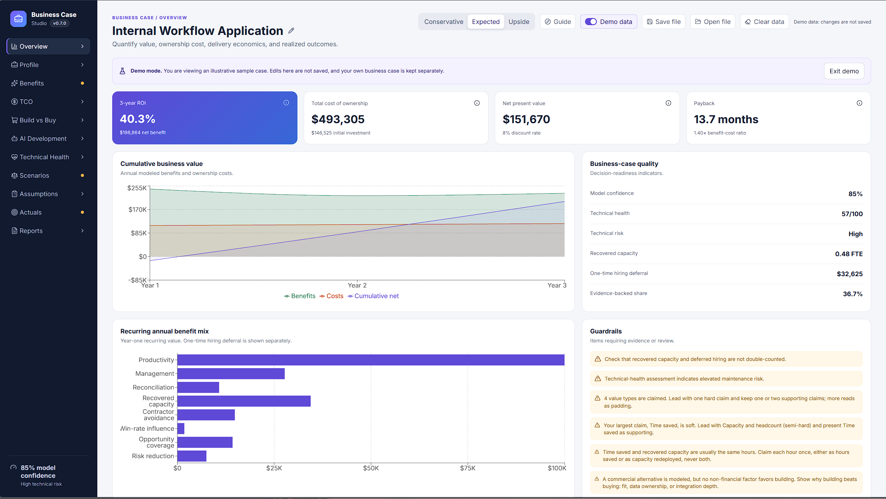
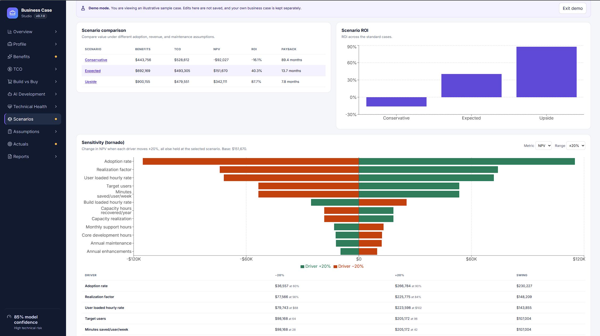

# Business Case Studio

[](https://github.com/egarlepp/businesscase_studio/actions/workflows/ci.yml)
[](LICENSE)

Model the ROI, total cost of ownership, risk, and realized value of internally developed,
AI-assisted, and vibe-coded applications.

AI-assisted development makes applications look cheap because the visible token bill is small.
The real cost includes requirements, prompting, review, remediation, security, hosting, support,
governance, and technical debt. On the other side, internal tools create value that revenue-only
ROI models miss: recovered capacity, avoided hiring, faster reporting, and reduced risk.
Business Case Studio puts both sides in one transparent model.

> **Status:** early MVP (v0.10.0). Runs entirely in the browser with no backend. Your model is
> autosaved in this browser only; use **Save file** (the disk icon at the right of the header)
> to keep or share it as JSON. Default numbers are illustrative — replace them with your own
> approved assumptions.





_Screenshots show the built-in demo data (turn on **Demo data**, the flask button at the bottom of the sidebar). More in
[docs/screenshots](docs/screenshots)._

## Features

| Section              | What it does                                                                                                                                                                                                                                                                                                         |
| -------------------- | -------------------------------------------------------------------------------------------------------------------------------------------------------------------------------------------------------------------------------------------------------------------------------------------------------------------- |
| **Overview**         | ROI, TCO, NPV, payback, benefit-cost ratio with "how is this calculated" explanations; cumulative value chart, benefit mix, model confidence, and guardrail warnings                                                                                                                                                 |
| **Profile**          | Initiative name, sponsor, currency, horizon, discount rate, growth rates, user segments, loaded labor rates, and the Scope panel that decides which pages apply                                                                                                                                                      |
| **Benefits**         | Choose which of 15 value types to claim (time, capacity, revenue, risk, hard cost reduction, retention, cycle time, cash acceleration, quality, compliance, ramp, forecast, CX, tech debt, strategic optionality), tag each hard, semi-hard, or soft with its baseline source, and review claims for double counting |
| **TCO**              | Build labor (discovery through launch), run platform, support, maintenance, enhancements, governance, security, training, and a technical-debt reserve                                                                                                                                                               |
| **Build vs Buy**     | Commercial-alternative TCO, NPV and ROI on the same horizon and discount rate, benefit-fit adjustment, build/buy/close-call verdict, non-financial checklist, and vendor-evidence check                                                                                                                              |
| **AI Development**   | Token economics, subscriptions, human oversight hours, traditional-build comparison, and time-to-market value                                                                                                                                                                                                        |
| **Technical Health** | Ten-dimension maintainability score that drives a risk rating and a suggested technical-debt reserve                                                                                                                                                                                                                 |
| **Scenarios**        | Conservative / Expected / Upside comparison and a tornado sensitivity analysis (NPV or ROI, ±10–30%)                                                                                                                                                                                                                 |
| **Assumptions**      | Editable register: add, edit, and remove assumptions with owner, source, confidence, and approval status                                                                                                                                                                                                             |
| **Actuals**          | Forecast-versus-actual variance, initial-investment variance, payback progress, and ROI at the actual run rate                                                                                                                                                                                                       |
| **Reports**          | Executive summary, audience briefing, key metrics, build-vs-buy summary, calculation trace, cash-flow CSV, an AI briefing pack (copy or download as Markdown) for writing a memo or deck with an AI assistant, and print / Save as PDF                                                                               |

**Guided walkthrough.** Open **Guide** in the header at any time. Five setup questions (who you
are presenting to, the initiative's stage, which kinds of value you will claim, whether it is
AI-assisted, and whether a commercial product exists) decide which steps apply. The guide then
opens each page in turn, explains what the step does, shows example inputs you can apply or
replace, and lists the questions to answer first. Progress is kept in this browser, so you can
close it and pick up where you left off.

**Scope.** The Scope panel on Profile (also asked in the walkthrough) records the application
type, users, data sensitivity, AI use, integrations, buy option, and stage. The answers mark
AI Development, Build vs Buy, Technical Health, and Actuals as essential, optional, or not
applicable (you can override each), suggest the value types that fit, and add guardrails for
essential costs left at zero. Pages that do not apply are greyed out in the navigation and can be
hidden. Their inputs are kept and any costs they carry still count.

**Pitch audiences.** IT manager, CIO / CTO, CFO / Finance, CRO / Sales leader, COO / Operations,
CISO / Risk, and Board / Investment committee each define the metrics to lead with, which modeling
scenario to present first, the pages they scrutinize (marked with a dot in the navigation), a
storyline, and the questions to expect. The Reports page adds an audience briefing. Audiences are
separate from the Conservative / Expected / Upside modeling scenarios.

**AI briefing pack.** On Reports, pick an audience and a memo, a slide deck, or both, then copy the
pack or download it as Markdown and paste or attach it to an AI assistant such as Claude. The pack
holds every scenario's results, ROI with soft claims removed, each claim's evidence class and
baseline source, costs, cash flow, top sensitivity drivers, scope, assumptions, and guardrail
warnings, plus a prompt that follows the audience's storyline and tells the assistant to quote
figures exactly and never calculate or invent them. The app sends nothing; check the result against
Reports before presenting it.

**Named cases and files.** The page heading is the case name; select the pencil beside it to rename
the case. Save file, Open file, and Clear data are icon buttons at the right of the header (hover
or focus one to see its label). Saved files are JSON named after the case and also carry the
walkthrough's answers and progress.

**Help as you go.** The info icon beside every input explains what it means and how the model uses
it, with a link to a web search for the concept. Hover or tap a scenario to see what it adjusts.
The version pill next to the app name in the sidebar opens **What's new** with the latest release
notes; a dot marks releases you have not opened yet.

The formulas, scoring rubric, and decision guidance are documented in
[docs/METHODOLOGY.md](docs/METHODOLOGY.md).

## Getting started

Requires Node.js 20.19+ (22 recommended, see `.nvmrc`).

```bash
npm ci
```

```bash
npm run dev
```

Then open <http://localhost:5173>. To reach the dev server from another device, run
`npm run dev -- --host`.

## Scripts

| Command           | Purpose                                       |
| ----------------- | --------------------------------------------- |
| `npm run dev`     | Start the Vite dev server                     |
| `npm run build`   | Type-check and produce a production build     |
| `npm run preview` | Serve the production build locally            |
| `npm test`        | Run engine and UI tests (Vitest)              |
| `npm run lint`    | Lint with ESLint                              |
| `npm run format`  | Format with Prettier                          |
| `npm run check`   | Everything CI runs: format, lint, test, build |

## Project structure

```text
src/
  App.tsx                       UI shell: navigation, pages, charts, reports
  version.ts                    APP_VERSION shown in the sidebar pill
  calculations/engine.ts        Pure calculation engine (all formulas live here)
  calculations/formulas.ts      Formula registry behind the in-app explanations
  calculations/sensitivity.ts   Tornado (one-at-a-time) sensitivity analysis
  data/assumptions.ts           Assumption-register helpers and evidence checks
  data/defaults.ts              Sample inputs, assumptions, scenario multipliers
  data/valueTypes.ts            The 15 value types, evidence classes, and baseline sources
  data/scope.ts                 Scope questions, module tiers, and scope guardrails
  data/changelog.ts             Release notes behind the What's new dialog
  persistence/draft.ts          Versioned draft format, import validation, autosave
  export/csv.ts                 Cash-flow CSV export
  export/briefingPack.ts        AI briefing pack: figures, caveats, and an audience-tuned prompt
  ui/fields.ts                  Every input's label and page location
  ui/fieldHelp.ts               Plain-language help behind each input's info tooltip
  ui/explainers.ts              Scenario and confidence explanations
  ui/format.ts                  Currency-aware formatting
  ui/buildVsBuy.ts              Build-vs-buy headline, checklist tally, chart series
  ui/components/                Field, FormulaInfo, HintTooltip, CaseTitle, Scope, ValueClaims,
                                SensitivityPanel, BuildVsBuyPanel, AssumptionRegister, ChartTable,
                                Walkthrough, AudienceBriefing, BriefingPackPanel, ThemeToggle,
                                WhatsNewDialog, Workspace
  guide/                        Walkthrough steps, pitch audiences, claim review, saved progress
  workspace/                    Blank start, demo mode, and Clear data
  theme/                        Light, dark, and system theme preference
  types/index.ts                Input and result types
docs/METHODOLOGY.md             Formulas and decision guidance
```

The engine is a pure function (`calculateBusinessCase(inputs) → results`) with no UI
dependencies, so it can be tested and reused independently. `formulas.test.ts` perturbs each
input to prove the formula registry matches what the engine actually computes.

## Blank start and demo data

On first launch the app asks whether to **start blank** (every figure zero, no names or
assumptions) or **explore demo data** (an illustrative sample case). The **Demo data** switch (the flask
button at the bottom of the sidebar) flips between the two at any time. Demo edits are kept in memory only; your own case stays
saved and returns when the switch is turned off. **Clear data** zeroes every figure and removes all
assumptions after a confirmation. Horizon (3 years), discount rate (8%), working weeks (48), and
productive hours (1,880) keep standard values on a blank case, and technical-health scores start at
3 (Moderate) until assessed.

Other features can call these actions through `useWorkspace()` in `src/workspace/useWorkspace.ts`
(`startBlank`, `enterDemo`, `exitDemo`, `clearAllData`, plus `demoMode` and `isBlank`).

## Light and dark mode

The sun, moon, and monitor buttons at the bottom of the sidebar pick light mode, dark mode, or
match the system setting (the default). The choice is kept in this browser. Charts follow the theme,
and printing always uses the light theme.

## Data and privacy

There is no server. Your model is autosaved to this browser's `localStorage` and never transmitted.
Anyone with access to the same browser profile can see it; use **Clear data** to erase it and start
blank. Exported
JSON and CSV files, and the AI briefing pack, can contain sensitive staffing and financial data; store them accordingly. The app never calls an AI service: pasting the briefing pack into an assistant sends it to that provider, so follow your organization's rules for that tool. See
[SECURITY.md](SECURITY.md).

## Roadmap

Tracked as [GitHub issues](https://github.com/egarlepp/businesscase_studio/issues?q=is%3Aissue+label%3Aroadmap).
Issues labeled [`good first issue`](https://github.com/egarlepp/businesscase_studio/issues?q=is%3Aissue+is%3Aopen+label%3A%22good+first+issue%22)
are a good place to start contributing.

**Now**

- [#18](https://github.com/egarlepp/businesscase_studio/issues/18) Team-specific benefit breakouts (drafts are versioned, so saved models can be
  migrated)

**Done in v0.9.0 and v0.10.0** (not tracked as issues): dark mode, and an AI briefing pack on
Reports for turning the case into a memo or deck.

**Done in v0.8.0**: guided setup that recommends which modules apply
([#19](https://github.com/egarlepp/businesscase_studio/issues/19)).

**Done in v0.4.0**: build-versus-buy comparison and an editable assumption register
([#17](https://github.com/egarlepp/businesscase_studio/issues/17)).

**Done in v0.3.0**: drafts and import ([#6](https://github.com/egarlepp/businesscase_studio/issues/6)), formula explanations ([#7](https://github.com/egarlepp/businesscase_studio/issues/7)), tornado
analysis ([#8](https://github.com/egarlepp/businesscase_studio/issues/8)), currency ([#9](https://github.com/egarlepp/businesscase_studio/issues/9)), print and CSV ([#10](https://github.com/egarlepp/businesscase_studio/issues/10)), payback with growth
([#11](https://github.com/egarlepp/businesscase_studio/issues/11)), health-based reserve ([#12](https://github.com/egarlepp/businesscase_studio/issues/12)), actuals ([#13](https://github.com/egarlepp/businesscase_studio/issues/13)), UI tests ([#14](https://github.com/egarlepp/businesscase_studio/issues/14)),
accessibility ([#15](https://github.com/egarlepp/businesscase_studio/issues/15)), and Dependabot fixes ([#16](https://github.com/egarlepp/businesscase_studio/issues/16)).

## Contributing

See [CONTRIBUTING.md](CONTRIBUTING.md).

## License

[MIT](LICENSE)
